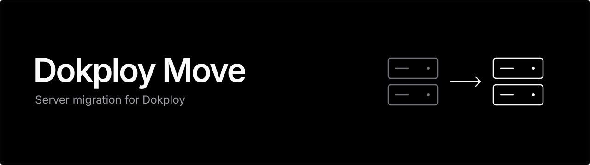
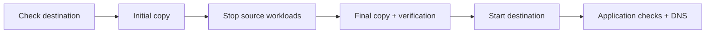

<p align="center">
  
</p>

<p align="center">
  <a href="https://github.com/Wezzeso/dokploy-move/actions/workflows/quality.yml"></a>
  
  
  
</p>

<p align="center">
  A local browser console for moving a <strong>single-node Dokploy server</strong><br>
  to a fresh, matching Linux host—with its supported local projects and data together.
</p>

<p align="center">
  <a href="#get-started">Get started</a> ·
  <a href="#what-moves">What moves</a> ·
  <a href="docs/dokploy-server-migration.md">Operator guide</a> ·
  <a href="#verification">Verification</a>
</p>

---

Moving a server should not mean rebuilding every project by hand. Dokploy Move
coordinates the initial transfer, stops source Docker workloads for cutover,
copies the final changes, verifies the copy, and starts the destination. Existing
application images and database versions stay together.

- **One migration console.** Destination checks, progress, job logs, and explicit recovery controls.
- **Local state travels together.** Dokploy settings, local databases, volumes, uploads, images, secrets, and certificates.
- **Plan before downtime.** Copy most bytes in advance, then run the final switch during maintenance.
- **Reconnect to your job.** Remote jobs continue if the browser, launcher, or SSH connection closes.

> [!IMPORTANT]
> Cutover stops **every Docker workload on the source**. This is a full local
> Docker/Dokploy migration for compatible hosts; it does not transfer the whole
> operating system or data held by external services. Rehearse on disposable
> matching VMs and keep an independent backup before a production move.

## Get started

### 1. Prepare the servers and SSH

| Requirement | Before you begin |
|---|---|
| Source | A supported **single-node Linux Dokploy** installation |
| Destination | Fresh host with an empty, running Docker Engine, outside any Swarm; do not install Dokploy there |
| Compatibility | Same Linux distribution/release, CPU architecture, Docker/containerd versions, storage driver, and daemon/systemd configuration |
| Server tools | Docker, Python 3, rsync, and the usual systemd/util-linux tools; sufficient disk headroom |
| Workstation | Python **3.10+** and OpenSSH; no pip packages required |
| SSH | Passwordless root access **workstation → source → destination**, with both host keys verified |
| Network | A static IPv4 address actually assigned to the destination; under provider NAT, use its local address for Swarm |

Configure aliases, identity files, and custom ports in the workstation's
`~/.ssh/config` for the source, and the source's `/root/.ssh/config` for the
destination. The tool enforces strict host-key checking, accepts no passwords or
private keys, and does not forward your SSH agent.

Read the [full prerequisites and unsupported configurations](docs/dokploy-server-migration.md#what-moves-and-what-remains-external)
before choosing a destination.

### 2. Open the console

Clone or [download this repository](https://github.com/Wezzeso/dokploy-move/archive/refs/heads/main.zip):

```bash
git clone https://github.com/Wezzeso/dokploy-move.git
cd dokploy-move
```

**Windows:** double-click [`scripts/dokploy-move.cmd`](scripts/dokploy-move.cmd).

**Any workstation with Python and OpenSSH:**

```bash
python scripts/dokploy-move-ui.py
```

The launcher opens the console in your browser on a random loopback port. It
uploads the matching engine to the source automatically. Use `--no-browser` to
open the printed URL yourself, or `--port 8765` for a fixed port.

> [!NOTE]
> Keep the complete console URL private. It contains a fresh access token;
> keep the console on loopback and do not expose it through a proxy or port forward.

### 3. Check, then move

1. Enter `root@SOURCE`, `root@DESTINATION`, and the destination's assigned IPv4.
2. Select **Check destination**. Review compatibility, storage coverage, and capacity.
3. Pause deployments and maintenance, stop non-Docker processes that write the
   copied data, acknowledge the outage, and select **Move all local projects**.

The successful check must match the source, destination, IP, and engine version
used for the move. Follow the job log through completion, then perform the
[DNS and application checks](#finish-the-move).



For a scheduled outage, use **Prepare initial copy** ahead of maintenance, then
**Run final switch** during the outage. Transfer and verification time depend on
your data, disks, and network; there is no fixed downtime guarantee.

## What moves

| State | Coverage |
|---|---|
| Dokploy configuration | `/etc/dokploy`, Compose checkouts, keys, settings, and proxy certificates |
| Local databases and uploads | All supported local Docker volumes, including database files and application uploads |
| Docker state | `/var/lib/docker`: images, writable container layers, build caches, networks, and Swarm state |
| Containerd state | `/var/lib/containerd`, including its image store when used |
| Secrets and access | Environment values, registry credentials stored in Docker/Dokploy, and Swarm secrets |
| Application bind mounts | Supported local paths discovered from existing containers and Swarm services, copied to the same locations |
| Application identity | User records, password hashes, MFA keys, sessions, schema, grants, and migration history held in copied local data |

Files retain numeric owners, permissions, ACLs, extended attributes,
within-directory hard links, and sparse-file layout over encrypted SSH.
Applications are copied at their existing versions; the move does not rebuild
or upgrade them.

**Handle separately:** external databases and S3 contents, remote deployment
servers, DNS, provider firewalls and IPs, OS packages, cron jobs, and external
integrations. Their stored connection settings remain in the copied state.
The destination keeps its OS identity and SSH host keys; its hostname is set to
the source hostname for placement compatibility.

The engine refuses configurations it cannot safely support, including occupied
destinations, multi-node Swarms, custom Docker data roots, Swarm autolock, live
restore, rootless/user-namespace/SELinux engines, Docker plugins, unsupported
volumes/filesystems, device passthrough, and host-specific port bindings.
Undeployed Compose paths, cross-directory hard links, and symlinks outside copied
locations require separate review. See the [coverage details](docs/dokploy-server-migration.md#what-moves-and-what-remains-external).

## Jobs and recovery

Jobs run through `systemd-run` on the source. Reopen the launcher, enter the same
source, and select **Reconnect / refresh status** to read the latest job and log.
Reconnecting never retries a migration automatically. A server reboot interrupts
its job; an unknown result blocks new console actions until inspected.

The source Docker/containerd services stay **masked after cutover**, including
across reboots, to prevent two copies of the cluster running. Do not start Docker
manually during a move or recovery.

**Resume source safely** requires proof that destination activation has never
begun and its runtime is stopped. It refuses recovery when the destination is
unreachable. Once the destination is `activating` or `active`, inspect and repair
the destination: restarting the old copy can reintroduce stale data or repeat
worker actions.

Use the [failure and recovery guide](docs/dokploy-server-migration.md#failure-and-recovery)
for interrupted transfers, uncertain activation results, and direct CLI commands.
Keep migration records; do not edit or delete them to bypass guards.

## Finish the move

1. Open Dokploy on the destination using its existing hostname; a local hosts-file
   override lets you check it before changing public DNS.
2. Update the server IP in **Web Server → Server → Update IP** and review old-IP references.
3. Check logins/MFA, database records, uploads/downloads, and each application's
   important flows. Healthy containers alone do not prove a successful application restore.
4. Configure the destination firewall, update DNS A/AAAA records, verify HTTPS,
   and review provider allowlists, SMTP, OAuth callbacks, bots, and storage access.
5. Keep the old server stopped and retain an independent backup through your recovery window.

## Verification

Run the two Python suites and the browser-controller suite with Python 3.10+
and Node.js 24:

```bash
python scripts/test_dokploy_move.py
python scripts/test_dokploy_move_ui.py
node --test scripts/dokploy-move-ui.test.mjs
```

Local verification completed on Windows and Linux:

| Environment | Passed | Skipped |
|---|---:|---:|
| Windows | 65 | 1 Linux-only rsync check |
| Linux (Ubuntu under WSL) | 66 | 0 |

Coverage includes migration ordering and refusal guards, recovery state,
secret-safe errors, local HTTP protection, preflight gates, reconnection,
localization, and eight browser-controller tests. On Linux with rsync, the engine
suite also checks a real temporary-directory copy and metadata round trip.

These checks use mocked Docker/SSH orchestration and local fixtures. They do
**not** establish a successful live Docker/Swarm restore; matching-VM rehearsals
and application checks remain required. See the [workflow](.github/workflows/quality.yml)
for the repository's automated checks.

---

Built for Dokploy operators. The [operator guide](docs/dokploy-server-migration.md)
documents the migration model, direct CLI, limitations, and recovery procedures.
